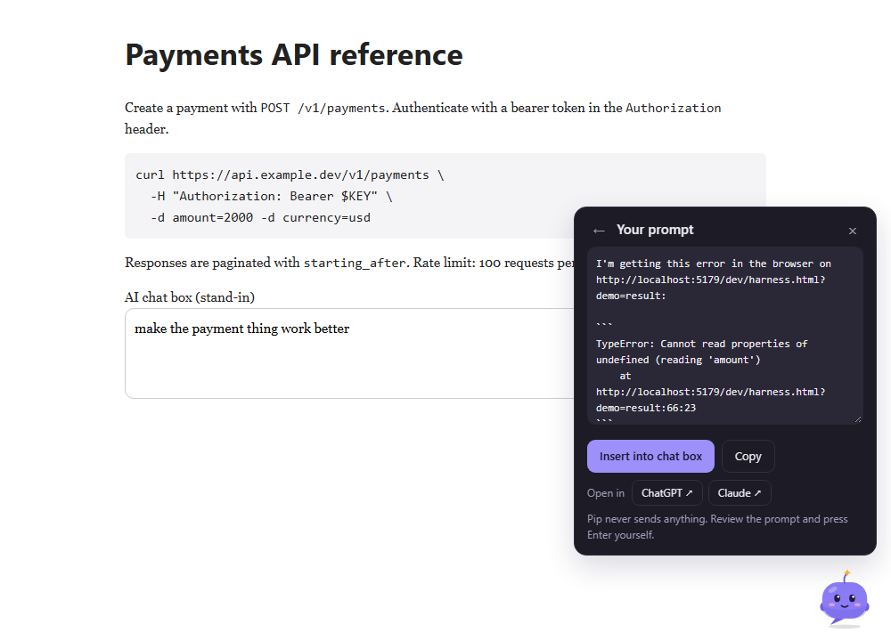
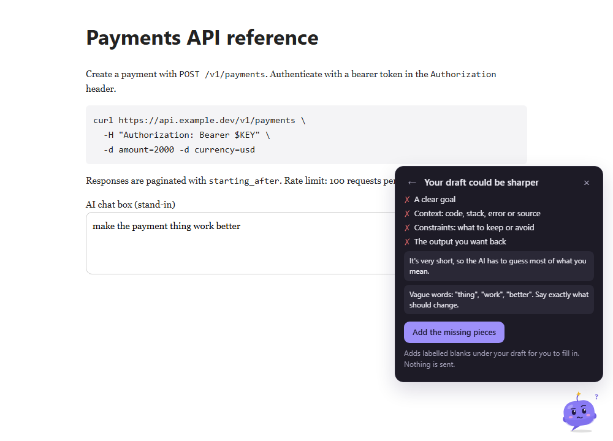
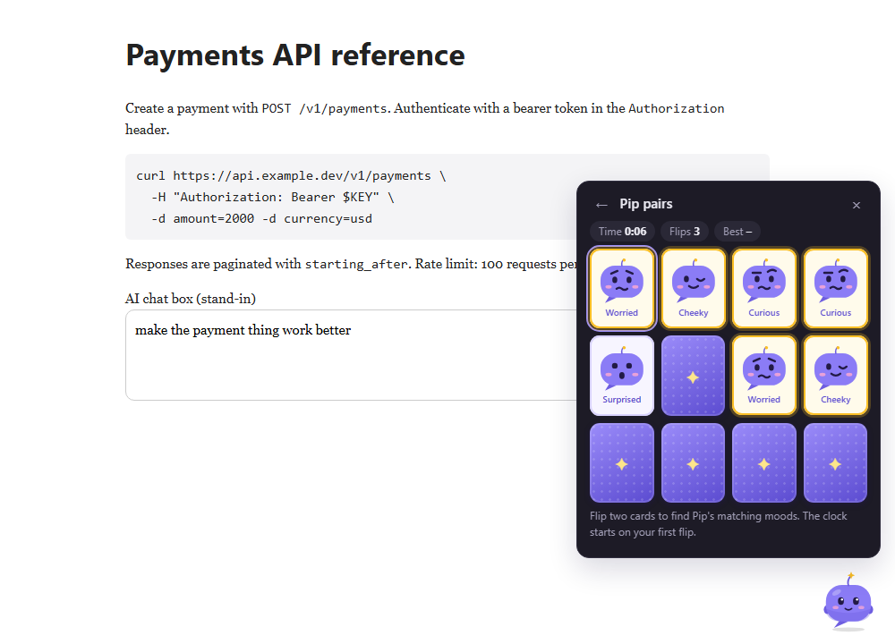

# Pip – prompt helper

A sleepy little browser helper that turns the page you're on into a great AI prompt. **Pip writes prompts; you send them.**

Pip sleeps in the bottom-right corner of your browser. Wake it and it suggests a prompt template that fits the page: a console error, a GitHub pull request, API docs, a migration guide, a ticket, or code you've selected. Answer up to three quick questions and Pip fills in the rest from the page. Review the prompt, then insert it into the chat box, copy it, or open it in a new ChatGPT or Claude chat.

No account, no API key, no servers. Nothing leaves your browser.

| Writes the prompt from the page | Checks your rough draft | Plays games while you wait |
|---|---|---|
|  |  |  |

## Install it for yourself (free, about 1 minute)

Pip isn't in a store yet. You can install it straight from this repo in Chrome, Edge, Brave, Arc, Opera or any other Chromium browser:

1. Get the code: click **Code → Download ZIP** above and unzip it, or run:
   ```bash
   git clone https://github.com/ShashGreninja/pip-prompting.git
   ```
2. Open `chrome://extensions` (`edge://extensions` in Edge).
3. Turn on **Developer mode** (top-right toggle).
4. Click **Load unpacked** and select the **`extension`** folder inside the repo.
5. Pin Pip from the puzzle-piece menu, then reload any tabs that were already open.

It stays installed across browser restarts. To update later, run `git pull` (or download again), then click the reload icon on Pip's card in `chrome://extensions`.

## Using Pip

- **Wake Pip:** click it, or press **Alt+Shift+P**. The shortcut works even when Pip is hidden. Change it at `chrome://extensions/shortcuts`.
- **Pick a template:** Pip suggests ones that fit the page. You can also search or browse all 15.
- **Answer and choose context:** answer the quick questions, untick any page context you don't want included, then **Write my prompt**.
- **Send it on your terms:** **Insert into chat box**, **Copy**, or **Open in ChatGPT / Claude**. That last one opens a new chat and pastes the prompt there. If you're not signed in, Pip waits and pastes it once you are. Pip never presses Enter.
- **Check my draft:** if the chat box already has a rough prompt, Pip checks it for a goal, context, constraints and an output format, and can add labelled blanks for whatever's missing.
- **Settings:** save your stack, working style and test framework once, and Pip adds them to every prompt.
- **Play with Pip:**
  - Spark catch: catch prompt pieces, dodge vague words.
  - Vague pop: pop the vague words floating up.
  - Pip pairs: a card-matching game.

  All three are high-score games.
- **Stay out of the way:** Pip falls asleep after 20 seconds (configurable). Hide it on any site or everywhere from the toolbar popup.

### Templates

Take inspiration from a site · Check writing for AI-sounding text · Mine a page for ideas · Integrate an API · Upgrade a library · Fix a console error · Describe a bug · Turn a design into a component · Write tests · Refactor safely · Explain code · Turn a ticket into a plan · Review a pull request · Compare your open tabs · Write a system prompt

Templates are plain Markdown files with a little frontmatter. See [extension/templates/README.md](extension/templates/README.md) to write your own.

## Project structure

```
extension/                 the extension itself: load this folder in Chrome
  manifest.json
  background.js            service worker: templates, screenshots, other tabs, PR diffs, ChatGPT/Claude handoff
  content/
    errors-main.js         runs in the page's JS world; keeps the last 10 console errors
    context.js             reads page context; finds and fills chat boxes
    templates.js           renders templates, suggests them for a page, checks drafts
    games/                 kit.js (shared canvas + scoring), one file per game, index.js
    panel-styles.js        the panel's CSS
    pip.js                 Pip's dock, state machine and panel (in a closed shadow root)
  shared/                  Pip's artwork, settings, template parser (shared with popup/options)
  templates/               the 15 prompt templates (Markdown + frontmatter)
  popup/  options/  icons/
dev/                       harness.html runs the content scripts on a normal page with stubbed chrome.* APIs
scripts/check.js           offline checks: manifest references, syntax, every template
scripts/screenshots.ps1    renders docs/images/*.png from the harness with headless Chrome
docs/                      publishing notes, privacy policy, the original prototype
```

There's no build step and no dependencies. The scripts share a few globals (`PipContext`, `PipTemplates`, `PipGames`, …), and the manifest lists them in load order.

## Development

```bash
npm test
```

This checks that every file the manifest references exists, that every script parses, and that every template uses known slots and renders cleanly. It also runs on GitHub Actions for every push.

```bash
npm run dev
```

Then open http://localhost:5179/dev/harness.html to work on Pip without reloading the extension. Add `?demo=home|result|draft|pairs` to jump straight to a screen, or `?handoff` to simulate arriving on Claude with a prompt waiting.

After changing extension files, click the reload icon on Pip's card in `chrome://extensions` and refresh your tabs.

## Privacy

Pip reads a page only when you open a template, shows you what it will include, and puts the finished prompt only in your chat box or clipboard. Settings live in your browser's extension storage. The only network request Pip makes is fetching a GitHub pull request's `.diff` when you use the PR review template. Full details are in [docs/publishing/privacy-policy.html](docs/publishing/privacy-policy.html).

## Known limitations

- **Chat box detection:** works for ChatGPT, Claude and Gemini, and for any text box you've typed in on the page. If a site changes its markup, update `CHAT_SELECTORS` in `extension/content/context.js`. Copy always works.
- **Screenshots** are offered as Copy or Save for you to attach yourself.
- **Console errors** are captured by wrapping `console.error`, so DevTools may attribute those lines to `errors-main.js`.
- **Firefox** isn't supported yet: it needs a `background.scripts` entry instead of a service worker.

## Publishing

[docs/publishing/store-listing.md](docs/publishing/store-listing.md) has ready-to-paste listing text and permission justifications for the Microsoft Edge Add-ons store (free to register) or the Chrome Web Store (one-time $5 fee).

## License

[MIT](LICENSE)
